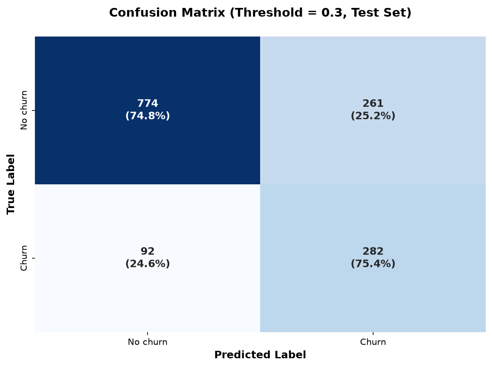
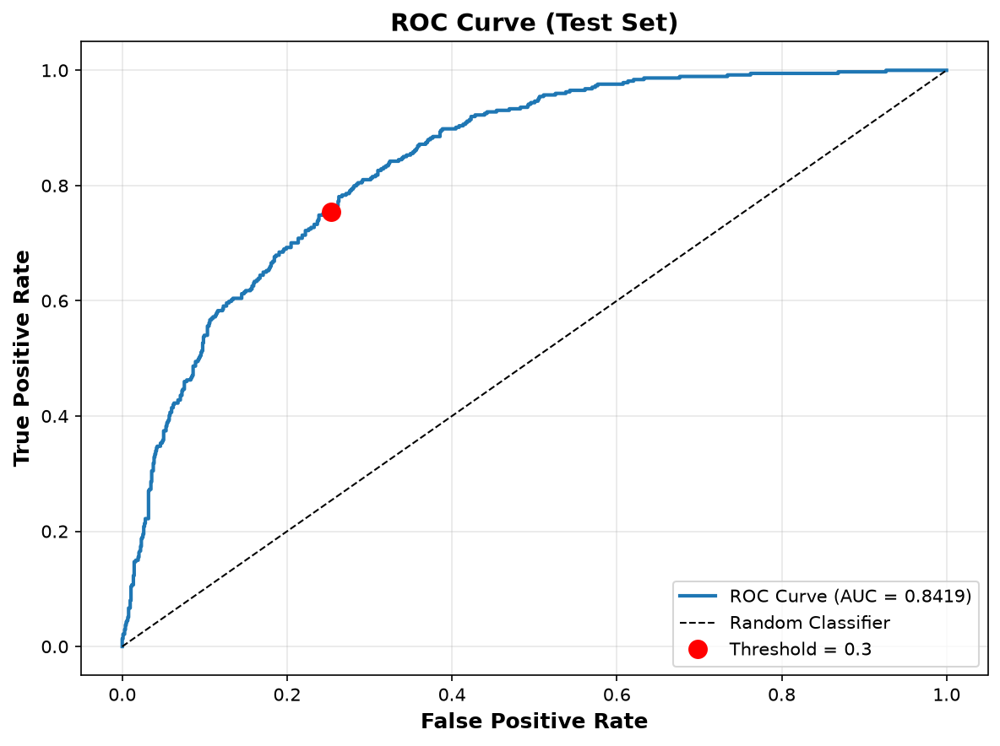
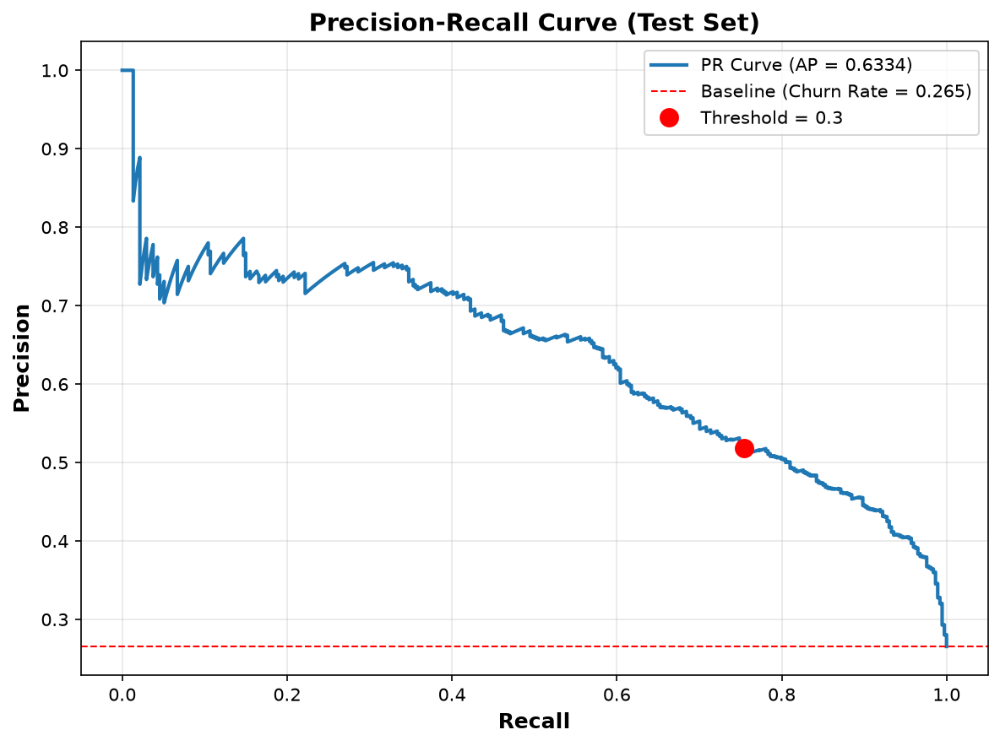
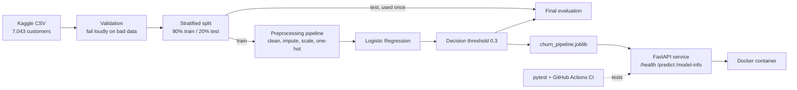

# Customer Churn Prediction


An end-to-end machine learning project: predict which telecom customers are likely to leave, and serve those predictions through a tested, containerized API.

The focus is on engineering practice rather than a leaderboard score: leakage-safe preprocessing, a decision threshold chosen for a business goal, automated tests, Docker, and CI.

**Author:** Hassan Shehzad ([GitHub](https://github.com/hassanshehzad1))

## Problem

A retention team can only contact so many customers. The goal is to flag customers likely to churn so they can be contacted early. Missing a real churner (false negative) is treated as more costly than a false alarm (false positive), so the model is tuned for **recall**, not accuracy.

- **Data:** Telco Customer Churn (Kaggle), 7,043 customers, 21 columns, 26.5% churn
- **Task:** binary classification, positive class = `Churn == "Yes"`

## Final Result (held-out test set, 1,409 customers)

Final model: Logistic Regression with a preprocessing pipeline, **decision threshold 0.3**.

| Metric | Value |
|---|---|
| Recall | 75.4% |
| Precision | 51.9% |
| F1 | 61.5% |
| ROC-AUC | 0.842 |
| PR-AUC | 0.633 (baseline 0.265) |

At threshold 0.3 the model caught 282 of 374 real churners (92 missed) and raised 261 false alarms. At the default 0.5 it caught only 209 (165 missed), which is why the threshold was moved.

| | Predicted no churn | Predicted churn |
|---|---|---|
| **Actually stayed** | 774 | 261 |
| **Actually churned** | 92 | 282 |





No modeling decision (model, features, or threshold) was made using the test set. It was used for the final evaluation, and afterwards only for error analysis and the report figures.

## Architecture



## Model Selection

Compared with 5-fold cross-validation on the training set only (default threshold 0.5):

| Model | Accuracy | Precision | Recall | F1 |
|---|---|---|---|---|
| Majority class | 73.5% | 0.0% | 0.0% | 0.0% |
| **Logistic Regression** | **80.4%** | **65.8%** | **54.9%** | **59.8%** |
| Decision Tree | 71.3% | 46.1% | 47.2% | 46.6% |
| Random Forest | 78.4% | 61.9% | 48.2% | 54.2% |

The majority-class row shows why accuracy alone is misleading here: always predicting "no churn" scores 73.5%.

What I tried after the baseline:
- **Engineered features** (new-customer flag, risky-contract flag, spend ratio, service count). Each separated churners well on its own, but they did not improve cross-validated recall or F1, so they were left out of the final model. The code is kept in `src/features/preprocessing.py`.
- **Gradient Boosting and a depth-limited Random Forest.** Neither beat Logistic Regression.
- **Class weighting and threshold tuning.** Both raise recall. Threshold tuning alone was chosen for simplicity.

The final comparison numbers above come from cross-validation at threshold 0.5. The final model's numbers come from the test set at threshold 0.3. They are not directly comparable.

## API

| Endpoint | Purpose |
|---|---|
| `GET /health` | Service is running |
| `GET /model-info` | Model type, threshold, training date, test metrics |
| `POST /predict` | Churn probability and Yes/No decision for one customer |

Inputs are validated with Pydantic (malformed requests return 422). The model loads once at startup. Interactive docs with a prefilled example are at `/docs`.

## Run It

```bash
# Local
pip install -r requirements.txt
uvicorn api.main:app --reload
# open http://127.0.0.1:8000/docs

# Docker
docker build -t churn-prediction-api .
docker run -p 8000:8000 churn-prediction-api
```

For development (notebooks, tests, MLflow): `pip install -r requirements-dev.txt`.

To retrain or run the data-dependent tests, download the dataset from Kaggle and save it as `data/raw/telco_customer_churn.csv`. It is not included in this repo and keeps its own license.

## Tests

19 tests cover data validation, model behavior (valid probabilities, determinism), and the API (including rejection of bad input).

```bash
python -m pytest tests/ -v
```

GitHub Actions runs them on every push. Because the dataset is not in the repo, 7 tests that need it are skipped on CI (12 run). All 19 run locally.

## Project Structure

```
api/        FastAPI app and request/response schemas
src/        data loading, validation, preprocessing, training, evaluation
tests/      pytest suite
models/     saved pipeline and metadata
reports/    result figures
notebooks/  exploratory analysis
```

## Limitations

- **Blind spot.** About 77% of the missed churners were "confident misses" (predicted probability below 0.25). Compared with the churners it does catch, they skew toward longer-tenure (about 29 vs 12 months on average), lower-spending DSL customers. The model is best at catching new, high-spending fiber-optic customers.
- **No cost data.** The 0.3 threshold reflects the stated assumption that a missed churner costs more than a false alarm. Without real retention-offer costs and customer values, it is a reasoned choice, not an optimized one. On validation data a threshold of 0.4 gave a slightly higher F1 at lower recall.
- **One static dataset.** Results come from a single public dataset and a single train/test split. There is no drift monitoring or retraining pipeline.
- **Associations, not causes.** Feature importance shows what the model relies on, not why customers leave.

## Possible Next Steps

Add features aimed at the missed segment, calibrate probabilities, choose the threshold from real cost figures, and add drift monitoring.

## Dataset and License

Dataset: [Telco Customer Churn](https://www.kaggle.com/datasets/blastchar/telco-customer-churn) (Kaggle), used under its own terms. Code is MIT licensed, see `LICENSE`.
